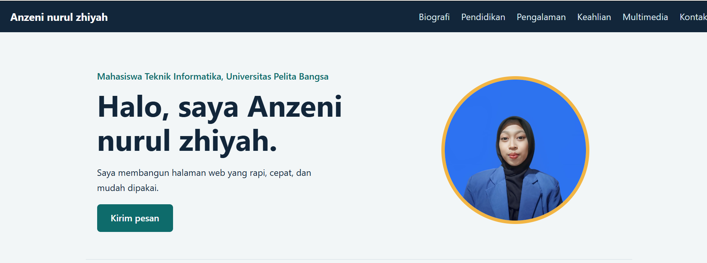
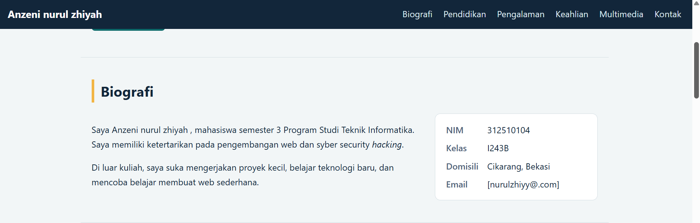
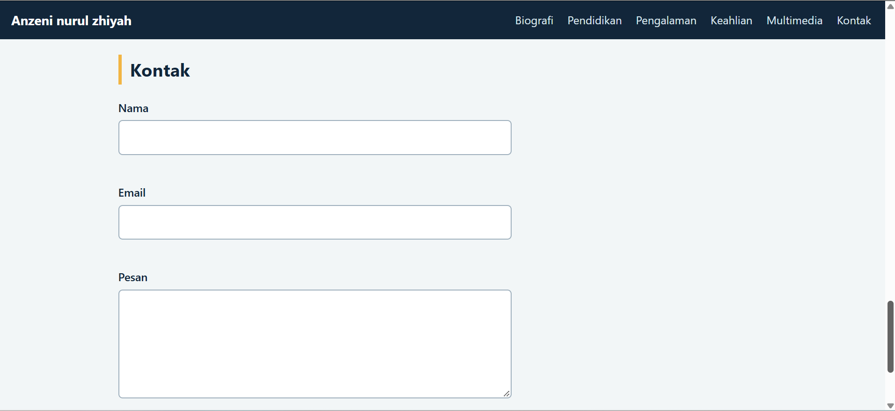

# UTS Pemrograman Web – Profil Pribadi

- Nama: [Anzeni nurul zhiyah]
- NIM: [312510104]
- Kelas: I243B
- Dosen: Sufajar Butsianto, S.Kom, M.Kom

## Deskripsi
Website profil pribadi (personal portfolio) ini dibuat untuk memenuhi tugas ujian tengah semester (UTS)mata kuliah pemrograman web yang , website ini menampilkan profil pribadi, riayat pendidikan, pengalama kerja dan organisasi,keahlian, serta informasi kontak.

## Teknologi
- HTML5
- dan sedikit javascript
- CSS33
- 
## Struktur Folder
```
UTS_Web_NIM_Nama/
├── index.html
├── style.css
├── images/   (profil.jpg, imagelain.jpg)
├── media/    (audio.mp3, video.mp4)
└── README.md
```

## Proses Pembuatan
1. Membuat kerangka dokumen dengan elemen semantik: header, nav, main, section, article, aside, figure, footer.
2. Menyusun header, navigasi (menu hamburger di layar kecil), dan hero panel.
3. Mengisi biografi dan data diri (dl).
4. Membuat tabel riwayat pendidikan dan pengalaman kerja (caption, thead, tbody, th scope).
5. Menyusun riwayat keahlian dengan ul dan ol.
6. Menambahkan elemen multimedia: video, audio, dan gambar.
7. Membuat form kontak dengan validasi (nama min. 3 karakter, format email, pesan min. 10 karakter, penghitung karakter).
8. Styling di style.css: CSS variables, flexbox, grid, media query, hover dan focus state.

## Screenshot Hasil

### Tampilan Desktop


### Tampilan Mobile


### Validasi Form

